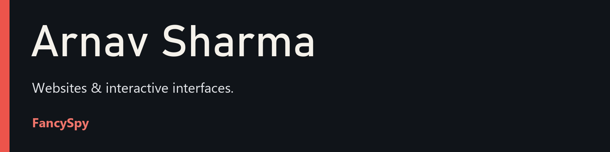
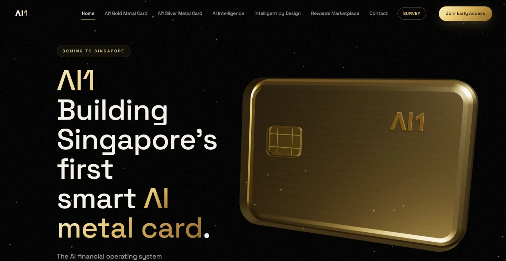
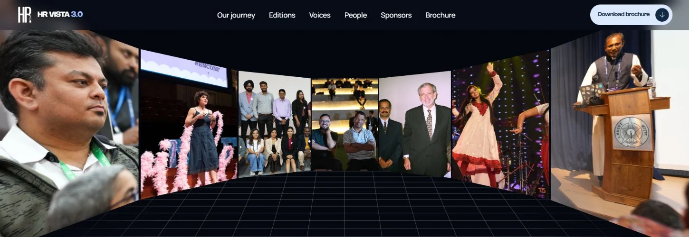

I'm **Arnav**, a Computer Science & Data Science student at **CHRIST University, Pune–Lavasa**. I build responsive websites and interactive interfaces with React, Next.js and TypeScript.

**[Explore my portfolio](https://arnav-spy-portfolio.vercel.app)** · [LinkedIn](https://www.linkedin.com/in/arnav-sharmaaa/) · [Get in touch](mailto:arnav.devworks@gmail.com)

## Selected work

### AI1 Card
Client marketing website for a prelaunch product. **Delivered client work.**

### HR VISTA 3.0
An event website bringing together editions, speakers and partners. **In development.**

### More things I'm building
- **Sparkle** — a project-based assistant with an Android companion alpha. In development.
- **[CampusLink](https://github.com/arnav-honeyyyeater/Christ-Bus-tracking-And-Care)** — a student commute prototype with timetables, simulated shuttle tracking and care contacts.
- **[Campus Connect](https://github.com/arnav-honeyyyeater/Campus-connect)** — a campus community prototype.

## Working with

- **Frontend:** HTML, CSS, JavaScript, TypeScript, React, Next.js, Tailwind CSS
- **Backend & data:** Python, Supabase, PostgreSQL
- **Tools:** Git

## Small website projects

Open to scoped landing pages, mobile layout fixes and frontend improvements. Send your page URL or brief to **[arnav.devworks@gmail.com](mailto:arnav.devworks@gmail.com)**; scope, price and timing are agreed before work starts.
