  

 

I'm an undergraduate studying **Computer Science &amp; Data Science** at **CHRIST University, Pune**. I build applied AI systems, autonomous workflows, and modern web applications with a focus on reliable architecture and craft.

---

### Selected Work

- **[Sparkle](https://github.com/arnav-honeyyyeater/Sparkle)** - Multimodal AI assistant prototype with 5-stage semantic state choreography, headless Bezier models, and Web/Android Canvas parity.
- **[Campus Connect](https://github.com/arnav-honeyyyeater/Campus-connect)** - University platform backend built with Next.js 15, Supabase, and PostgreSQL Row-Level Security (RLS).
- **[CampusLink](https://github.com/arnav-honeyyyeater/Christ-Bus-tracking-And-Care)** - Transit tracking and student care showcase featuring geofenced arrival notifications.
- **[AI1 Card](https://github.com/arnav-honeyyyeater/Portfolio)** - Client marketing website for a pre-launch fintech product engineered for sub-100ms LCP.
- **[Mobile VPN](https://github.com/arnav-honeyyyeater/Laptop-s-Vpn-on-mobile-)** - Lightweight Python network routing and proxy utility.

---

### Stack

`TypeScript` · `Next.js` · `React` · `Tailwind CSS` · `Python` · `Supabase` · `PostgreSQL`

---

### Connect

- **Email:** [arnav.devworks@gmail.com](mailto:arnav.devworks@gmail.com)
- **Location:** Pune, India (UTC +05:30)
