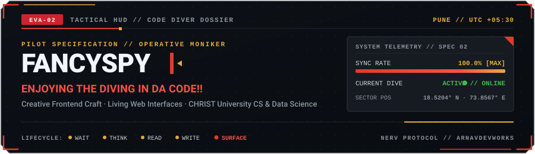

<picture>
  <source media="(prefers-color-scheme: dark)" srcset="https://raw.githubusercontent.com/arnav-honeyyyeater/arnav-honeyyyeater/main/assets/header_fancyspy_dark.svg">
  <source media="(prefers-color-scheme: light)" srcset="https://raw.githubusercontent.com/arnav-honeyyyeater/arnav-honeyyyeater/main/assets/header_fancyspy_light.svg">
  
</picture>

 

### "Enjoying the Diving in DA Code!!"

**Pune, India (UTC +05:30)** • **CHRIST University CS & Data Science** • **Status: Diving Deep**

 

<picture>
  <source media="(prefers-color-scheme: dark)" srcset="https://raw.githubusercontent.com/arnav-honeyyyeater/arnav-honeyyyeater/main/assets/divider_fancyspy_dark.svg">
  <source media="(prefers-color-scheme: light)" srcset="https://raw.githubusercontent.com/arnav-honeyyyeater/arnav-honeyyyeater/main/assets/divider_fancyspy_light.svg">
  
</picture>

### 📋 Mission Dossier // The Code Diver

Most digital surfaces feel like cold, rigid scaffolding. I dive deep into system complexity to surface with interfaces that feel fluid, intentional, and alive.

Known online as **FancySpy** (`arnav-honeyyyeater`), I combine the sharp precision of an Eva Unit-02 pilot with the relentless curiosity of an undercover code diver. By day, I study Computer Science and Data Science at CHRIST University (Pune-Lavasa), analyzing system architecture and distributed data patterns. By night, I craft high-velocity web surfaces that respect human attention and turn interaction into craft.

My baseline philosophy: websites should feel natural. Tactile like paper, responsive like muscle memory, and built with uncompromising engineering discipline.

---

### 🚀 Classified Operations // Selected Sorties

<table>
<tr>
<td width="50%" valign="top">

#### 🌸 Sparkle // AI Companion Prototype
*Autonomous Workspace Assistant & Living State Machine*

- **The Living Metaphor**: Treats the forward slash `/` prompt as an organic seed that blooms into five soft petals, reflecting real system lifecycle states (Waiting, Thinking, Reading, Writing, Home).
- **Architecture**: Headless vector geometry computing Bezier curves with zero bloated dependencies. Shared coordinate fixtures guarantee pixel parity between Web (React/SVG) and Mobile (Android Canvas).
- **Surface**: [Explore Live Prototype Showcase](https://arnav-spy-portfolio.vercel.app)

</td>
<td width="50%" valign="top">

#### 🚍 CampusLink // Transit & Care System
*Mobility & Student Safety Network for CHRIST Lavasa*

- **The Objective**: Solves daily mountain transit friction for university commuters with real route timetables, simulated vehicle positions, and one-tap emergency care contacts.
- **Architecture**: Built with React, TypeScript, Supabase backend with Row-Level Security (RLS), and responsive Tailwind CSS layout systems.
- **Repository**: [Inspect Repository](https://github.com/arnav-honeyyyeater/Christ-Bus-tracking-And-Care)

</td>
</tr>
<tr>
<td width="50%" valign="top">

#### 💳 AI1 Card // Client Marketing Surface
*High-Conversion Showcase for Pre-Launch Fintech*

- **The Objective**: Hand-crafted editorial marketing experience for a pre-launch Singapore metal payment card, engineered for sub-100ms Largest Contentful Paint (LCP).
- **Architecture**: Next.js, React, performance-budgeted asset pipelines, and friction-free waitlist onboarding with fluid responsive typography.
- **Surface**: [View Client Showcase](https://arnav-spy-portfolio.vercel.app)

</td>
<td width="50%" valign="top">

#### 🏛️ HR VISTA 3.0 // Flagship Event Portal
*University Milestone Platform (In Active Development)*

- **The Objective**: Dynamic multi-stage editorial platform orchestrating the annual flagship journey from Lavasa to Mumbai, featuring edition archives and speaker showcases.
- **Architecture**: Modern component systems, event state management, and bespoke typography. Publicly credited on-site for development and maintenance.
- **Surface**: [View Portfolio Feature](https://arnav-spy-portfolio.vercel.app)

</td>
</tr>
</table>

#### 🛠️ Public Utility Archives

- **[Campus Connect](https://github.com/arnav-honeyyyeater/Campus-connect)**: University collaboration backend engineered with Next.js 15, Supabase, and PostgreSQL RLS.
- **[Mobile VPN](https://github.com/arnav-honeyyyeater/Laptop-s-Vpn-on-mobile-)**: Lightweight Python network routing utility and proxy tunnel for cross-device testing.
- **[Portfolio Webtech](https://github.com/arnav-honeyyyeater/Portfolio-webtech)**: Exploratory frontend laboratory and interactive experiment playground.

---

### ⚡ Tactical Arsenal // Systems & Instruments

  

| Tactical Class | Instruments & Methodologies Deployed |
| :--- | :--- |
| **Front of the Glass** | TypeScript, React, Next.js, Tailwind CSS, SVG Geometry, Responsive Design |
| **Behind the Glass** | Python, Supabase, PostgreSQL (Row-Level Security), REST APIs |
| **Craft & Choreography** | 5-Stage Semantic State Machines, WCAG AA Accessibility, Sub-100ms LCP |
| **Mission Standards** | Zero Slop, Zero Bloated Dependencies, Clean Modular Commits, Rapid Iteration |

---

### 📡 Secure Comms // Direct Transmission

Whether you have an ambitious web project, need an urgent frontend fix, or want to discuss interaction architecture:

- **Primary Dispatch**: [arnav.devworks@gmail.com](mailto:arnav.devworks@gmail.com)
- **Academic Terminal**: [arnav.sharma@bsccsdsh.christuniversity.in](mailto:arnav.sharma@bsccsdsh.christuniversity.in)
- **Professional Network**: [linkedin.com/in/arnav-sharmaaa](https://www.linkedin.com/in/arnav-sharmaaa/)
- **Visual Journal**: [@honey_eatshoney](https://www.instagram.com/honey_eatshoney)
- **Portfolio Showcase**: [arnav-spy-portfolio.vercel.app](https://arnav-spy-portfolio.vercel.app)

 

  EVA UNIT-02 // CODENAME: FANCYSPY • COORDINATES: PUNE, INDIA • ALL TRANSMISSIONS LOGGED

