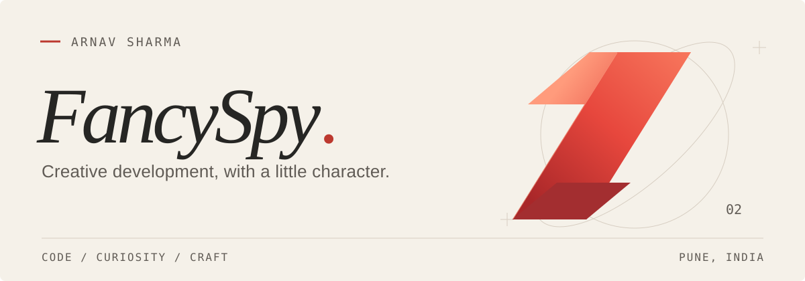

<picture>
  <source media="(prefers-color-scheme: dark)" srcset="https://raw.githubusercontent.com/arnav-honeyyyeater/arnav-honeyyyeater/main/assets/header_fancyspy_dark.svg">
  <source media="(prefers-color-scheme: light)" srcset="https://raw.githubusercontent.com/arnav-honeyyyeater/arnav-honeyyyeater/main/assets/header_fancyspy_light.svg">
  
</picture>

 

### Thoughtful interfaces. A little personality.

I'm **Arnav Sharma**, a Computer Science & Data Science student at **CHRIST University, Pune–Lavasa**. I build websites, explore interaction design, and turn ideas into things you can use.

**[Explore my portfolio ↗︎](https://arnav-spy-portfolio.vercel.app)** &nbsp; · &nbsp; [LinkedIn](https://www.linkedin.com/in/arnav-sharmaaa/) &nbsp; · &nbsp; [Email](mailto:arnav.devworks@gmail.com) &nbsp; · &nbsp; [Instagram](https://www.instagram.com/honey_eatshoney)

 

## Selected work

**[AI1 Card ↗︎](https://ai1card.com/)** &nbsp; CLIENT WORK · DELIVERED\
A product website introducing the AI1 Card offering and its prelaunch information.

**[HR VISTA 3.0 ↗︎](https://arnav-spy-portfolio.vercel.app)** &nbsp; WEB EXPERIENCE · IN PROGRESS\
An event website connecting editions, people, and partners through an interactive story. Featured in my portfolio.

**[Sparkle ↗︎](https://arnav-spy-portfolio.vercel.app)** &nbsp; AI WORKSPACE · IN DEVELOPMENT\
A project-based assistant for conversations, research, and local organization, with an Android companion alpha. Featured in my portfolio.

**[CampusLink ↗︎](https://github.com/arnav-honeyyyeater/Christ-Bus-tracking-And-Care)** &nbsp; CAMPUS MOBILITY · PROTOTYPE\
A student commute experience with timetables, simulated shuttle tracking, and care contacts.

More experiments &amp; small builds

- **[Campus Connect](https://github.com/arnav-honeyyyeater/Campus-connect)** — a campus community prototype.
- **[Laptop-to-Mobile Proxy](https://github.com/arnav-honeyyyeater/Laptop-s-Vpn-on-mobile-)** — a Python HTTP / HTTPS proxy experiment.
- **[Web Technology Portfolio](https://github.com/arnav-honeyyyeater/Portfolio-webtech)** — an early portfolio built with HTML and CSS.

 

## Tools I reach for

**Interfaces** &nbsp; `TypeScript` `React` `Next.js` `Tailwind CSS`\
**Behind the scenes** &nbsp; `Python` `Supabase` `PostgreSQL`\
**Everyday craft** &nbsp; `Git` `SVG` `Responsive design`

I'm especially interested in expressive motion, readable interfaces, and the small details that make software feel natural.

 

## Have something in mind?

A website, a frontend fix, or an interesting collaboration — **[let's talk ↗︎](mailto:arnav.devworks@gmail.com)**

---

Pune, India · Enjoying the diving in DA code.
