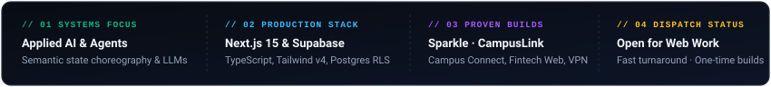
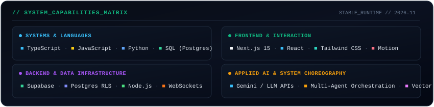
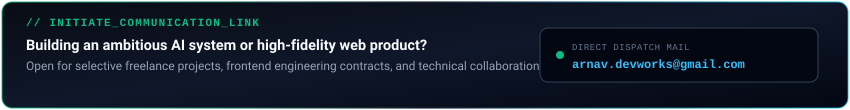

  

  

 

## Executive Summary

I am an undergraduate software engineer studying **Computer Science & Data Science** at **CHRIST (Deemed to be University), Pune Lavasa Campus**, specializing in **Applied AI Systems**, **Autonomous Multi-Agent Architectures**, and **High-Craft Web Engineering**.

My work bridges algorithmic intelligence with deterministic, production-grade applications. Whether choreographing real-time state machines for multimodal assistants, engineering secure PostgreSQL Row-Level Security backends, or crafting 60fps responsive interfaces, I build software that values precision, speed, and real architectural substance over disposable prototypes.

 

---

## Flagship Proof of Work

<table>
  <thead>
    <tr>
      <th width="35%">Project &amp; Repository</th>
      <th width="40%">Architecture &amp; Key Innovations</th>
      <th width="25%">Production Stack</th>
    </tr>
  </thead>
  <tbody>
    <tr>
      <td>
        <b><a href="https://github.com/arnav-honeyyyeater/Sparkle">Sparkle Assistant</a></b> 
        <i>Multimodal AI Assistant &amp; Voice Interaction System</i>
      </td>
      <td>
        • <b>Semantic State Choreography:</b> Real-time 5-stage state machine (<code>Waiting</code>, <code>Thinking</code>, <code>Reading</code>, <code>Writing</code>, <code>Home</code>) with quintic easing. 
        • <b>Headless Geometry Engine:</b> Shared mathematical Bezier and lerp models with zero bloated dependencies. 
        • <b>Cross-Platform Parity:</b> Identical coordinate fixtures shared across Web (React) and Mobile (Android Canvas).
      </td>
      <td>
        <code>React</code> 
        <code>TypeScript</code> 
        <code>Android Canvas</code> 
        <code>Motion</code> 
        <code>Gemini API</code>
      </td>
    </tr>
    <tr>
      <td>
        <b><a href="https://github.com/arnav-honeyyyeater/Campus-connect">Campus Connect</a></b> 
        <i>Full-Stack Social, Academic &amp; Resource Engine</i>
      </td>
      <td>
        • <b>Database Hardening:</b> Complete PostgreSQL migration with fine-grained Row-Level Security (RLS). 
        • <b>Encrypted Pipeline:</b> Student registration-number authentication and private media handling. 
        • <b>Realtime Streams:</b> Low-latency WebSocket feeds for events, social graph, clubs, and notifications.
      </td>
      <td>
        <code>Next.js 15</code> 
        <code>Supabase</code> 
        <code>PostgreSQL RLS</code> 
        <code>TypeScript</code> 
        <code>WebSockets</code>
      </td>
    </tr>
    <tr>
      <td>
        <b><a href="https://github.com/arnav-honeyyyeater/Christ-Bus-tracking-And-Care">CampusLink</a></b> 
        <i>Transit Telemetry &amp; Student Safety Showcase</i>
      </td>
      <td>
        • <b>Geofenced Notifications:</b> Boundary monitoring along transit routes (Ashiana &amp; Portofino to CHRIST Lavasa). 
        • <b>Predictive Arrival:</b> Real-time shuttle arrival predictions and dynamic schedule synchronization. 
        • <b>Emergency Protocol:</b> Integrated one-touch verified emergency response hotlines.
      </td>
      <td>
        <code>TypeScript</code> 
        <code>React</code> 
        <code>Tailwind CSS</code> 
        <code>Geofencing APIs</code> 
        <code>Maps Integration</code>
      </td>
    </tr>
    <tr>
      <td>
        <b>AI1 Card</b> 
        <i>Fintech Product Marketing Architecture</i>
      </td>
      <td>
        • <b>High-Conversion Showcase:</b> Responsive pre-launch card interface engineered for client marketing. 
        • <b>Performance Floor:</b> Sub-100ms Largest Contentful Paint (LCP) with zero layout shift. 
        • <b>Accessible Craft:</b> WCAG AA contrast compliance and micro-interactions honoring reduced motion.
      </td>
      <td>
        <code>Next.js</code> 
        <code>Tailwind CSS</code> 
        <code>Motion</code> 
        <code>TypeScript</code>
      </td>
    </tr>
    <tr>
      <td>
        <b><a href="https://github.com/arnav-honeyyyeater/Laptop-s-Vpn-on-mobile-">Mobile VPN Engine</a></b> 
        <i>Secure Tunneling &amp; Proxy Utility</i>
      </td>
      <td>
        • <b>Network Routing:</b> Bridges mobile client traffic securely through a host workstation connection. 
        • <b>Protocol Daemon:</b> Lightweight socket-level proxy handling packet forwarding without overhead.
      </td>
      <td>
        <code>Python 3</code> 
        <code>Socket API</code> 
        <code>Network Protocols</code>
      </td>
    </tr>
  </tbody>
</table>

 

---

## Technical Capabilities Matrix

  

 

| Layer | Technologies &amp; Tools | Focus Areas |
| :--- | :--- | :--- |
| **Languages &amp; Core** | TypeScript, JavaScript (ESNext), Python, SQL (PostgreSQL), C++ | Type-safe architectures, backend logic, data processing |
| **Frontend &amp; UI** | Next.js (App Router), React, Tailwind CSS v4, Motion, Radix UI | Zero-shift responsive layouts, fluid physics, design systems |
| **Backend &amp; Cloud** | Supabase, PostgreSQL RLS, Node.js, Fastify, REST &amp; WebSockets | Secure data access, private media pipelines, real-time pub/sub |
| **Applied AI &amp; Systems** | Gemini 3.8 / Live API, Multi-Agent Orchestration, Headless Bezier Math | Semantic state machines, voice streaming, evaluation |

 

---

## GitHub Analytics &amp; Telemetry

  
  

 

---

## Dispatch &amp; Inquiries

  

 

Available for selective freelance engagements, full-stack product builds, and technical collaborations:

- **Direct Inquiries:** [arnav.devworks@gmail.com](mailto:arnav.devworks@gmail.com)
- **Portfolio Showcase:** [arnav-honeyyyeater/Portfolio](https://github.com/arnav-honeyyyeater/Portfolio)
- **Location &amp; Timezone:** Pune, India · Indian Standard Time (UTC +05:30)

 

  Engineered with precision vector geometry · Built for production · © 2026 Arnav Sharma

