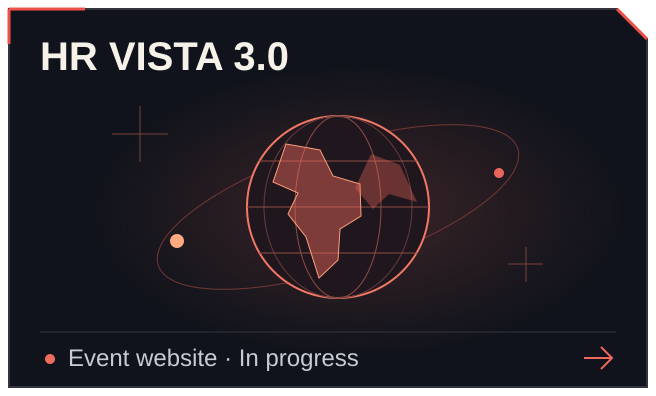
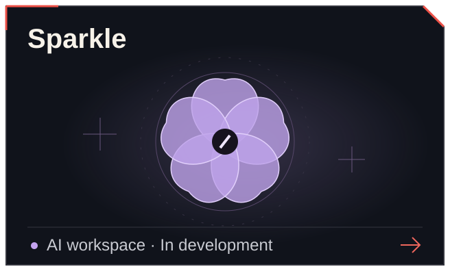
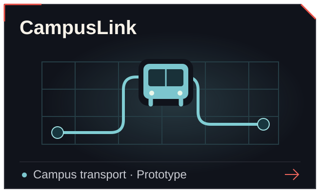

  

## Arnav Sharma

Computer Science & Data Science student at **CHRIST University, Pune–Lavasa**. I work on websites, interactive interfaces, and applications for everyday problems.

  <b><a href="https://arnav-spy-portfolio.vercel.app">Portfolio ↗︎</a></b>
  &nbsp;&nbsp;·&nbsp;&nbsp; <a href="https://www.linkedin.com/in/arnav-sharmaaa/">LinkedIn</a>
  &nbsp;&nbsp;·&nbsp;&nbsp; <a href="mailto:arnav.devworks@gmail.com">Email</a>
  &nbsp;&nbsp;·&nbsp;&nbsp; <a href="https://www.instagram.com/honey_eatshoney">Instagram</a>

## Selected projects

  
  
  
  

<b>About these projects</b>

- **AI1 Card** — a delivered freelance website introducing the product and its prelaunch information.
- **HR VISTA 3.0** — an event website bringing together editions, people, and partners. In progress.
- **Sparkle** — an assistant for project-based conversations, research, and local organization, with an Android companion alpha. In development.
- **CampusLink** — a student commute prototype with timetables, simulated shuttle tracking, and care contacts.

## Technologies

**Frontend** &nbsp; `TypeScript` `React` `Next.js` `Tailwind CSS`

**Backend & data** &nbsp; `Python` `Supabase` `PostgreSQL`

**Tools** &nbsp; `Git` `SVG`

## More repositories

- [**Campus Connect**](https://github.com/arnav-honeyyyeater/Campus-connect) — campus community prototype.
- [**Laptop-to-Mobile Proxy**](https://github.com/arnav-honeyyyeater/Laptop-s-Vpn-on-mobile-) — Python HTTP / HTTPS proxy experiment.
- [**Web Technology Portfolio**](https://github.com/arnav-honeyyyeater/Portfolio-webtech) — an early HTML and CSS portfolio.

---

**Contact:** [arnav.devworks@gmail.com](mailto:arnav.devworks@gmail.com) &nbsp; · &nbsp; Pune, India
